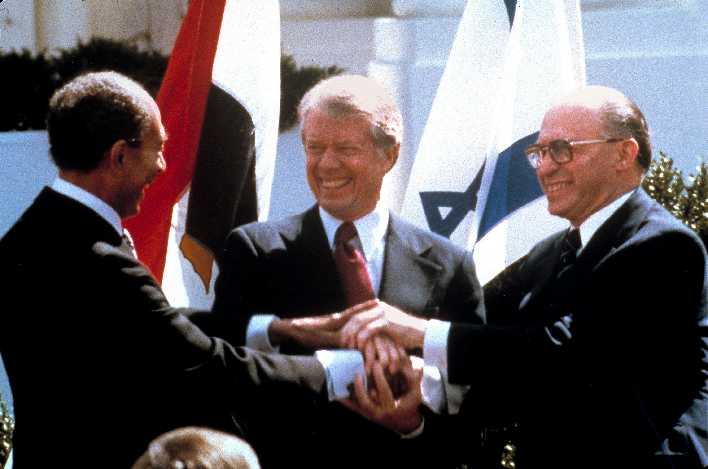
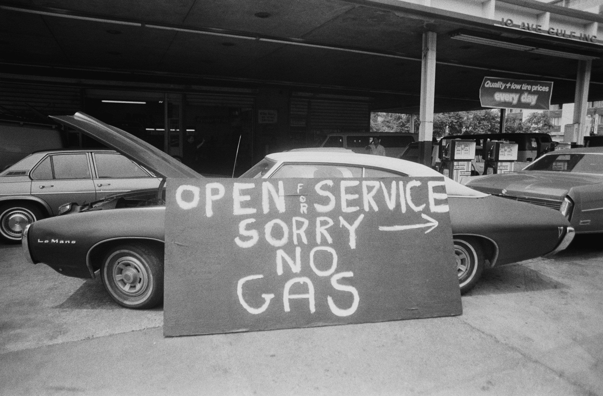
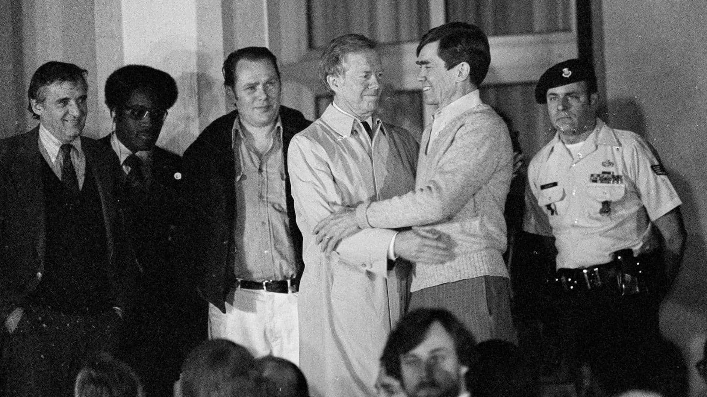
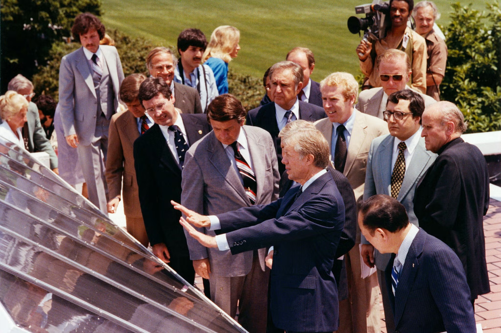
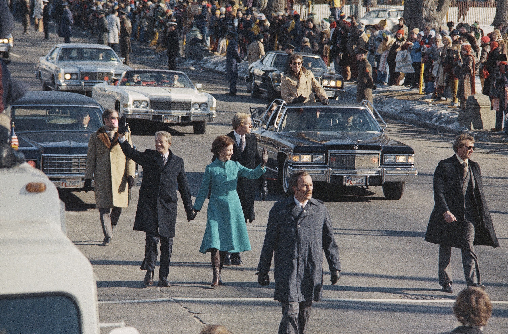

# The Carter paradox: why the "worst" modern president may have been the best

When I graduated from Georgia Tech in 1992 with a bachelor's degree in international affairs, our class was among the first through the program that became the Sam Nunn School. Studying foreign policy in Atlanta in the early 1990s kept Jimmy Carter in view. Carter had attended Georgia Tech in 1942 and 1943 as an NROTC engineering student before moving to the U.S. Naval Academy. Just a few miles from campus, the Carter Center was monitoring global elections, defending human rights, and working to eradicate Guinea worm disease.

Two professors shaped how I looked at presidential power. Dr. Linda Brady had served in the State Department and held other government posts under both Carter and Reagan. For a senior project under the late Dr. Michael Salomone, I conducted an institutional review of Lyndon Johnson, Richard Nixon, Jimmy Carter, and Ronald Reagan based on Richard Neustadt's _Presidential Power_.

Neustadt argued that the constitutional powers of the presidency amounted to a "clerkship," and that real authority was "the power to persuade" through bargaining, reputation, and leverage over Washington insiders and the public. In 1992, that framework left Carter looking weak. Popular memory focused on two-hour gas lines, 13.5% inflation, the 444-day Iran hostage crisis, and a televised address about a "crisis of confidence." When Ronald Reagan won 44 states and 489 electoral votes in 1980, the common verdict was set: Carter was a decent man and perhaps a great former president, but he lacked the political skill to run the Oval Office.

That verdict seemed flawed to me even then. During my senior year, I defended Carter's record in the _North Avenue Review_, the student opinion journal, arguing that observers were judging his term by the wrong standards.

Fifty years after the 1976 election, the numbers support that contrarian view. Judged by tangible outcomes—keeping the peace, addressing structural economic trouble, and anticipating long-term problems with an engineer's discipline—Carter compiled a record that compares favorably with any modern successor. The choice between his approach and that of later presidents comes down to what citizens want from the office: a showman who motivates a crowd, or an analytical steward who works through the details.

## A military record without a war

Data from Brown University's Costs of War Project and the Tufts University Military Intervention Project show the pattern of American intervention over the last fifty years:

- Ronald Reagan funded proxy wars in Central America that contributed to more than 75,000 deaths in El Salvador and 200,000 in Guatemala. The CIA's mining of Nicaraguan harbors brought the 1986 _Nicaragua v. United States_ ruling, the only time the International Court of Justice formally convicted the United States of unlawful use of force.
- George H.W. Bush sent 27,000 troops into Panama in 1989 and deployed more than 500,000 during the 1991 Persian Gulf War. The destruction of Iraq's electrical and water grids during the air campaign contributed to tens of thousands of civilian deaths from waterborne disease.
- George W. Bush launched regime-change invasions in Afghanistan in 2001 and Iraq in 2003 under the doctrine of preemptive war. Those conflicts cost $8 trillion, took more than 7,000 American military lives, caused over 900,000 direct war deaths (including nearly 400,000 civilians), and introduced torture at CIA black sites across 54 countries.
- Barack Obama relied on aerial warfare rather than ground invasions. He authorized 563 drone strikes in Pakistan, Yemen, and Somalia, compared to 57 under Bush, and dropped 26,171 bombs across seven countries in 2016 alone.
- Joe Biden ended the twenty-year ground war in Afghanistan and cut drone strikes by more than 80%. At the same time, his administration sent more than $65 billion in weapons to Ukraine and over $17.9 billion in military aid, including 14,000 two-thousand-pound MK-84 bombs, to Israel during a campaign in Gaza that killed more than 40,000 Palestinians.

Donald Trump campaigned as an opponent of foreign interventions and the long wars associated with Bush and Obama. His administration brokered the Abraham Accords and signed the 2020 Doha Agreement to withdraw from Afghanistan.

The operational record showed a different pattern. After loosening battlefield rules of engagement in 2017, the administration dropped 7,423 bombs and missiles in Afghanistan in 2019, an 18-year high compared to 947 in Obama's final year in 2015. In 2017, the United States carried out 39,577 strikes in Iraq and Syria, and Airwars documented an increase of more than 200% in civilian deaths caused by coalition strikes. Trump authorized 2,243 drone strikes during his first two years, exceeding Obama's eight-year total of 1,878 across all theaters. He revoked the 2016 executive order requiring the CIA to report civilian drone deaths, vetoed bipartisan resolutions to end U.S. support for the Saudi war in Yemen, pardoned four Blackwater contractors convicted in the 2007 Nisour Square killings of 14 unarmed Iraqi civilians, and ordered the assassination of Iranian General Qasem Soleimani.

During his second term, direct military action expanded in Venezuela, Yemen, and Iran. On February 28, 2026, during the opening strikes of the war against Iran, American Tomahawk cruise missiles hit the Shajareh Tayyebeh Elementary School in Minab during school hours. A second strike hit hours later as parents and first responders searched through the rubble. The strike relied on outdated intelligence fed through the military's AI-assisted Project Maven targeting system, which had not recorded that a former IRGC facility had been converted into a civilian school more than a decade earlier. The attack killed 156 civilians, including 120 school children (73 boys and 47 girls) and 26 teachers. A UN fact-finding mission, Amnesty International, and independent satellite analysts concluded the strike was indiscriminate, while Trump asserted that Iran had bombed its own school and the Pentagon withheld its internal findings.

During his 1,461 days in office from 1977 to 1981, Carter started no foreign wars, launched no invasions, and ordered no combat bombing runs. The only American military deaths under his command occurred during Operation Eagle Claw, when eight service members died in an aircraft collision in the Iranian desert during the mission to rescue 52 American hostages.

Critics equated that restraint with hesitation, but Carter's diplomatic initiatives produced durable agreements. At Camp David in September 1978, Carter spent thirteen days negotiating with Israeli Prime Minister Menachem Begin and Egyptian President Anwar Sadat. The resulting peace treaty ended thirty years of conflict between Israel and its largest Arab neighbor, across four wars in 1948, 1956, 1967, and 1973, and has held for nearly half a century. In 1979, he normalized diplomatic relations with China. He also spent substantial political capital to pass the Panama Canal Treaties by a 68-32 Senate vote, one vote over the required two-thirds threshold, avoiding what the Joint Chiefs of Staff warned would require an extended counter-insurgency campaign involving 100,000 troops.

_Egyptian President Anwar Sadat, President Jimmy Carter, and Israeli Prime Minister Menachem Begin celebrate the signing of the peace treaty between Egypt and Israel following the Camp David Accords. The agreement ended thirty years of conflict between Israel and its largest Arab neighbor._

## Two common arguments about Carter's term

Critics regularly raise two arguments about Carter's presidency: that his policies caused the high gas prices and inflation of the late 1970s, and that he caused the Iran hostage crisis by admitting the deposed Shah to the United States. Declassified records and economic data show that neither claim holds up.

### The economy, fuel shortages, and inflation

Popular memory credits Ronald Reagan with fixing an economy that Carter broke. In fact, stagflation and fuel shortages grew out of decisions made under Johnson, Nixon, and Ford, and Carter took unpopular steps to resolve them.

Inflation began accelerating before Carter took office. It reached 12.3% in 1974 under Nixon and Ford, fueled by deficit spending for the Vietnam War, the 1973 OPEC oil embargo, and Richard Nixon's pressure on Federal Reserve Chairman Arthur Burns to keep credit cheap before the 1972 election.

The gas lines of 1979 formed even though global oil production dropped by only 4% to 7% during the Iranian Revolution. Lines formed because of federal price and allocation controls that Richard Nixon had imposed in August 1971. Those controls discouraged domestic exploration, subsidized imported oil, and prevented fuel from moving efficiently to cities with regional shortages.

_A service station displays a "Sorry No Gas" sign during the 1970s fuel shortages. Federal price caps and allocation rules imposed under Richard Nixon in 1971 created regional shortages until Carter initiated phased decontrol in April 1979._

Advisers warned Carter that lifting price controls on domestic oil would raise prices at the pump right before the 1980 election. He phased them out starting in April 1979 anyway. As expected, retail fuel prices jumped, which contributed to his loss in November. But deregulation prompted an immediate increase in domestic drilling and fuel conservation. Between 1977 and 1982, net U.S. oil imports dropped by half, from 8.6 million barrels a day to 4.3 million, loosening OPEC's leverage and creating the lower oil prices of the 1980s.

Carter took a similar approach to monetary policy. In August 1979, with inflation climbing toward 13.5%, he appointed Paul Volcker to chair the Federal Reserve. Carter understood that Volcker intended to tighten the money supply and raise the federal funds rate toward 20%, inducing a sharp recession during an election year. Carter never criticized Volcker publicly. By 1983, Volcker's policy brought inflation down to 3.2%, creating conditions for sustained growth over the next two decades.

During his four years, Carter kept the gross federal debt increase to roughly $299 billion, leaving the debt-to-GDP ratio steady at about 32%. Modern administrations have taken a different approach. Donald Trump attacked his own handpicked Fed chair, Jerome Powell, dozens of times to demand lower interest rates, delayed stimulus checks in 2020 so his signature would appear on the memo line for 70 million recipients, and added $7.8 trillion to the national debt in his first term.

Carter also deregulated several major industries and saw steady job growth:

- Even with the 1980 recession, the economy added 10.3 million jobs during Carter's term, an annual growth rate of 3.1%. That exceeded the job growth rates under Ronald Reagan (2.1%), Bill Clinton (2.4%), Barack Obama (1.3%), and Trump's first term (-0.4% post-COVID, or 1.6% pre-COVID).
- Carter signed the Airline Deregulation Act of 1978, the Staggers Rail Act of 1980, and the Motor Carrier Act of 1980. Within twenty years of airline deregulation, inflation-adjusted fares fell by almost 40%, and the proportion of Americans who had flown on an airplane more than doubled.
- In 1978, Carter signed H.R. 1337, which legalized homebrewing for the first time since Prohibition. The United States had 89 breweries when he took office; today more than 9,700 craft breweries operate across the country, generating $77 billion in economic activity.

### The Iranian revolution and the hostage crisis

Critics on the left argue that Carter provoked Iran by admitting Shah Mohammad Reza Pahlavi to the United States in October 1979, while critics on the right argue that he should have backed the Shah more forcefully. Neither account matches the record.

Anti-American feeling in Iran began long before 1979. In August 1953, the Eisenhower administration and the CIA organized Operation Ajax, which overthrew Iran's elected prime minister, Mohammad Mossadegh, and restored the Shah to power. Over the next twenty-five years, successive administrations armed the Shah's government and helped train his secret police, SAVAK. Under the Nixon Doctrine, the Shah served as Washington's primary regional security partner.

When the Shah fled Iran in January 1979, Carter refused to grant him entry for nine months. In meetings with advisers, Carter asked directly what they would advise if militants seized American personnel in Tehran in retaliation.

Carter admitted the Shah only after an extended lobbying campaign led by former Secretary of State Henry Kissinger, Chase Manhattan Bank Chairman David Rockefeller, and Council on Foreign Relations Chairman John J. McCloy. In October 1979, Rockefeller's physician told the State Department that the Shah needed specialized treatment for lymphoma at NewYork-Presbyterian Hospital. Kissinger also suggested he would oppose the SALT II nuclear treaty if the administration turned the Shah away. Carter agreed to a humanitarian exception on October 22, 1979.

Militants seized the U.S. Embassy thirteen days later. Rather than starting a war that could have resulted in the execution of the hostages or pushed Iran toward the Soviet Union, Carter froze $12 billion in Iranian assets and negotiated through Algerian intermediaries. Those talks produced the Algiers Accords, which secured the release of all 52 American hostages on his final morning in office.

_Former President Jimmy Carter embraces released hostages at the U.S. military hospital in Wiesbaden, West Germany, on January 21, 1981. All 52 American hostages were brought home alive through diplomatic negotiation and financial sanctions._

## Energy, conservation, and judicial appointments

Trained as a naval nuclear engineer under Admiral Hyman Rickover, Carter treated governance as an engineering problem that required long-term planning:

Along with lifting oil price caps, Carter established the Department of Energy, set the first mandatory CAFE fuel-economy standards, and placed 32 solar thermal panels on the White House roof in June 1979. He set an administrative goal for the country to draw 20% of its energy from renewable sources by 2000.

_President Jimmy Carter dedicates 32 solar hot-water panels on the roof of the White House on June 20, 1979. Carter pledged that 20% of the nation's energy would come from renewables by the year 2000; the panels were later removed during the Reagan administration in 1986._

In December 1980, Carter signed the Alaska National Interest Lands Conservation Act, setting aside 104.3 million acres of public land and doubling the size of the National Park and Wildlife Refuge Systems. That same month, he signed the Comprehensive Environmental Response, Compensation, and Liability Act (Superfund), creating a $1.6 billion trust fund financed by taxes on chemical and petroleum producers to clean up hazardous waste sites such as Love Canal.

Lastly, although he had no vacancies to fill on the Supreme Court, Carter used merit nominating commissions to appoint 56 Black, Hispanic, and Asian judges and 40 women to the federal bench, including Ruth Bader Ginsburg to the D.C. Circuit and Stephen Breyer to the First Circuit. Those 96 appointments exceeded the total number of women and minority judges confirmed under all 38 prior presidents combined.

## Two models of presidential leadership

In our review at Georgia Tech, we examined how different administrations applied persuasion. Lyndon Johnson used personal arm-twisting in the Senate cloakroom. Richard Nixon relied on executive secrecy and backchannels. Ronald Reagan used television and straightforward ideological themes.

According to Congressional Quarterly, Carter achieved an 80.7% legislative success rate in Congress, higher than Reagan (61.8%), Clinton (58.0%), George W. Bush (72.6%), or Trump during his first term (48.0%). Yet commentators and voters in 1980 viewed him as an ineffective politician.

That disconnect reflects two different views of executive leadership, similar to the contrast between head coaches in football.

One approach centers on motivation and culture. Coaches like Barry Switzer, Pete Carroll, Mike Ditka, or Dan Campbell focus on team confidence and public energy. They leave technical planning to coordinators and direct their attention to keeping players focused and resilient.

The other approach centers on strategy and structural design. Coaches like Bill Walsh, Joe Gibbs, Tom Landry, or Chuck Noll built specific systems. Walsh designed the West Coast offense around timed passes, while Gibbs adjusted blocking schemes and backfield alignments to win Super Bowls with three different starting quarterbacks. Their effectiveness came from preparation and detailed planning.

Both qualities matter in the presidency, but voters often prioritize the motivator.

### The communicator and public leader

Many voters look for leaders who can project confidence and unite a room. Most people have little time to study Federal Reserve targets, energy tax policy, or treaty negotiations; they want reassurance that a leader understands their concerns and can handle a crisis.

Presidents like Franklin Roosevelt, John F. Kennedy, Ronald Reagan, Bill Clinton, Barack Obama, and Donald Trump built their appeal on that emotional connection. Reagan and Obama delivered speeches that shaped the national mood. Trump adopted a combative version of the same role, holding large rallies, delegating policy work, and assuring audiences that his administration would deliver easy victories.

Carter rejected that theatrical style. When congressional leaders sent him a 1977 public works bill with nineteen local dam and water projects, he vetoed it as wasteful spending, angering House Speaker Tip O'Neill and leaders within his own party. He monitored small administrative details in the White House, sold the presidential yacht, _USS Sequoia_, and carried his own luggage. In his July 15, 1979 address, he offered an unsparing critique rather than an upbeat speech, warning that material wealth could not replace a sense of purpose.

_Jimmy and Rosalynn Carter break with tradition by walking down Pennsylvania Avenue during the 1977 Inaugural Parade. Carter avoided imperial ceremony throughout his presidency, emphasizing personal modesty and administrative frugality._

### The strategist and administrator

The limitation of rhetorical showmanship is that governing eventually requires technical competence. Mistakes in policy are measured in debt, ruined treaties, and lost lives.

This is where the analytical model matters. Carter approached the office as a trustee responsible for structural problems that would outlast his administration.

The difference in style shows up in how Carter and Trump handled comparable issues:

- Facing tension with Iran, Carter accepted the political cost of a 444-day hostage crisis and relied on financial pressure and negotiations to bring all 52 Americans home without starting a broader war. In 2026, Trump launched missile strikes that hit an elementary school in Minab, killing 120 children because the military relied on outdated targeting data, and then deflected responsibility to Iran.
- On the economy, Carter supported Volcker's interest rate hikes, lifted oil price caps despite the political fallout, and contained debt growth. Trump pushed for lower interest rates during an economic expansion and added trillions to the national debt.
- On energy, Carter encouraged conservation, lowered White House thermostats, and laid groundwork for renewable power. Trump dismissed conservation and focused exclusively on oil and gas extraction.
- In his personal finances, Carter placed his family's peanut business into a blind trust. He left office in 1981 to find it $1 million in debt, sold the business to pay creditors, and spent the rest of his life working on public health and election monitoring through the Carter Center. Trump maintained personal business interests in real estate, licensing, and digital assets throughout his presidency.

## Comparing presidential outcomes over fifty years

| Area (1976–2026)        | Conventional political leaders (Reagan, Obama, Trump)                       | Jimmy Carter                                                                        |
| :---------------------- | :-------------------------------------------------------------------------- | :---------------------------------------------------------------------------------- |
| Military operations     | Thousands of air and drone strikes, proxy wars, or direct interventions     | No wars initiated, no combat bombing runs ordered                                   |
| Iranian crisis outcomes | Trump (2026): Military strike on Minab school kills 120 children            | Carter (1979–1981): All 52 hostages returned alive; no combat deaths                |
| Diplomatic agreements   | Short-term agreements or treaty withdrawals (such as the Iran nuclear deal) | 1978 Camp David Accords (sustained peace between Egypt and Israel)                  |
| Inflation and energy    | Interest rate pressure and expanded federal borrowing                       | Appointed Paul Volcker; ended domestic oil price caps, cutting imports by half      |
| Annual job growth       | 2.1% (Reagan), 1.3% (Obama), -0.4% total or 1.6% pre-pandemic (Trump)       | 3.1% per year (10.3 million net new jobs)                                           |
| Conservation            | Mixed regulatory changes and public land leases                             | Protected 104.3 million acres in Alaska; established Superfund                      |
| Judicial appointments   | Appointments focused along party lines                                      | Appointed 96 women and minority judges, surpassing all previous presidents combined |

It is easy to see why voters respond to charismatic figures. Presidents who dominate the news and project unyielding confidence usually win immediate affection.

Yet when evaluated by policy outcomes—preventing wars, resolving structural inflation, protecting public lands, and preserving judicial independence—Carter's record stands up well against any modern presidency. He was never an effective cheerleader, and his refusal to manage public impressions cost him a second term. But fifty years later, many of the institutions, conservation areas, and diplomatic frameworks that define the modern United States trace directly back to the work he did in office.
